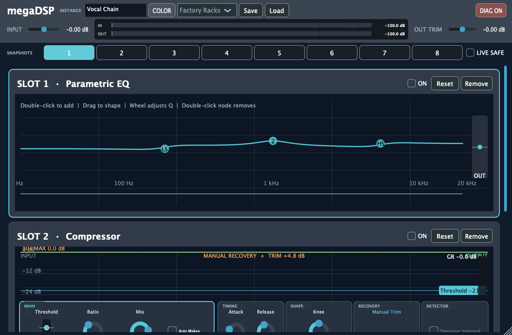
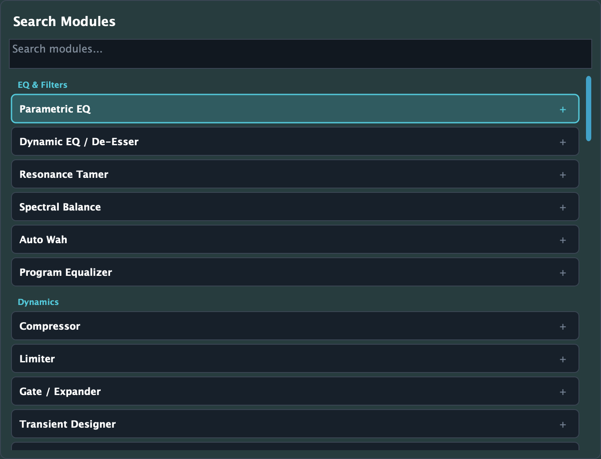
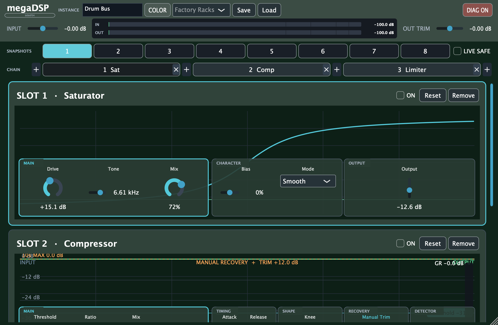
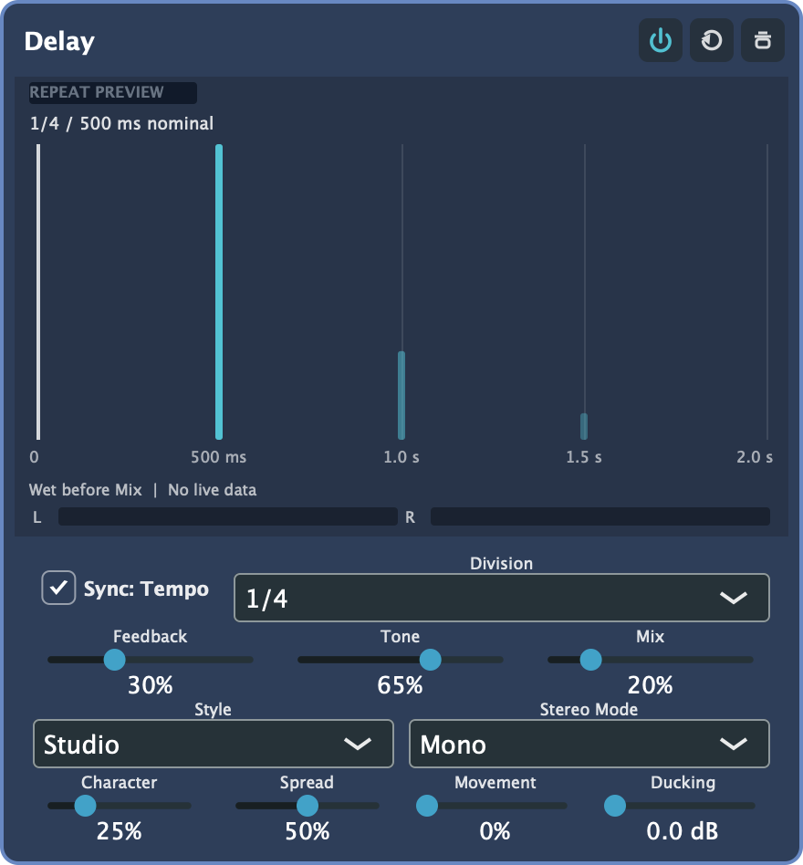
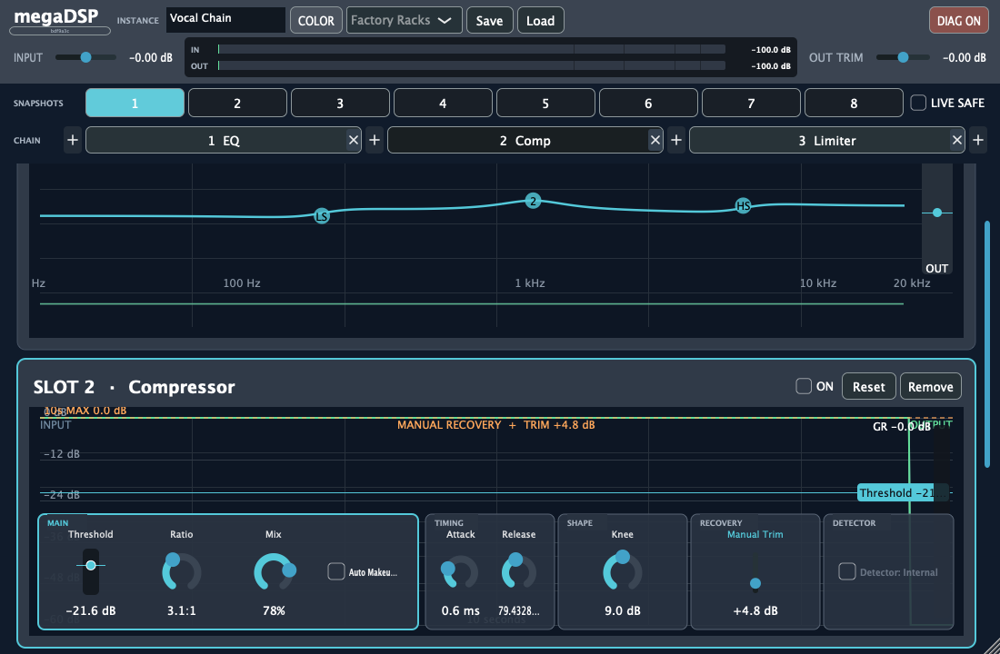
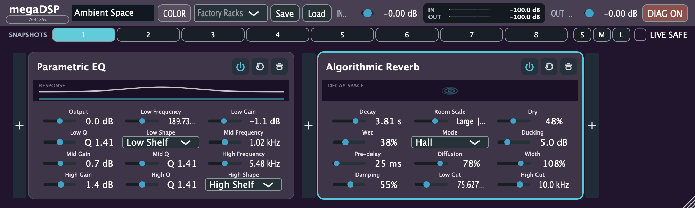

# megaDSP

[](https://github.com/kevinlong206/megaDSP/actions/workflows/build.yml)

megaDSP aims to be the only effects plugin you need in your DAW: one VST3, AU,
or CLAP plugin with a growing collection of high-quality, intuitive effects.
Use a module on its own or combine up to eight in a serial chain to shape,
transform, and finish your audio without juggling separate plugins.

Mono, mono-to-stereo, and stereo channel layouts are supported. In Logic Pro,
choose **Mono->Stereo** on a mono track to feed its signal equally into both
rack channels and retain stereo effect output. Host bypass keeps that signal
centered and preserves reported latency.

Logic caches Audio Unit channel capabilities by plug-in version. Builds that
change supported channel layouts must increment the configured plug-in version;
rescanning the same version can retain the previous layouts.

In Neural Amp Modeler, the cabinet name is shown only while its IR is enabled.
The **IR ON** button uses an accent color to indicate the active cabinet;
switching it off retains the profile's saved IR selection.
The loaded model and validated library rows identify the **A1** or **A2**
architecture generation. Filename-only entries omit this label until metadata
validation completes.

Choose **ULTRA** beside **S / M / L** for a bypass-only rack: 36-pixel module rows
stack from top to bottom in signal-flow order. Drag a row above or below another
to reorder; click its power button or press **Space / B** to bypass. **Up / Down**
select rows and **Alt+Up / Alt+Down** reorder them. The list scrolls vertically
when needed. Controls, asset loading, reset, insertion, and removal remain in
the S/M/L views; ULTRA leaves their values intact and suspends visualizations.
The selected view uses the existing global widget preference.

Eight complete **Snapshots** let one instance hold multiple racks. Click a
snapshot to recall it; clicking an unused snapshot activates a fresh blank rack
without copying the current one. Shift-click saves the current rack to an empty
snapshot or overwrites a populated one. Drag a populated snapshot onto another
slot to copy it without changing the source. MIDI
Program Change 0-7 recalls Snapshots 1-8 at the event sample. The selected
snapshot updates live as you edit, and up to two outgoing effect tails spill
into the new rack. Recall uses a zero-slope 20 ms transition. Snapshot spills
are capped at eight seconds and fade over their final 500 ms; sustained
generators such as Chord Loom and frozen spectral fields use a shorter
1.5-second spill so they do not linger indefinitely.

Enable **LIVE SAFE** for high-stakes monitoring or performance. megaDSP then
runs every populated snapshot continuously on silence, converting the brief CPU
spike at recall into predictable steady CPU usage. The active and transitioning
racks alone receive live input. Host latency updates wait until audio callbacks
stop, avoiding PDC rebuilds during monitoring without adding plugin latency;
timing may be temporarily offset after recalling a rack with different latency.

The header **DSP LOAD** readout shows megaDSP's average and held-peak share of
the current audio callback deadline. Click it for current load and headroom,
average, peak, p95/p99, deadline overruns, the actual sample rate/block/deadline,
a ten-second spike history, and per-module average/peak/share. The panel marks
offline rendering, LIVE SAFE, host bypass, and background NAM/IR work
separately; **RESET** clears its local history and statistics. This measures
megaDSP's real-time processing deadline rather than whole-system CPU, so it
remains useful in hosts that do not attribute CPU to individual plug-ins.

Creative spectral effects keep the live dry signal immediate: **Spectral
Prism**, **Pitch Bloom**, **Spectral Delay Canvas**, **Harmonic Mirage**,
**Time Mosaic**, and **Spectral Nebula** do not add delay compensation in the
DAW. Their transformed wet sound arrives after the analysis window as a natural
pre-delay. Phase-critical correction, lookahead, and nonlinear processors still
report and align the latency required for accurate processing.

Today, megaDSP includes fifty-nine purpose-built processors with interactive
graphs, realtime analysis, and controls that match the musical quantities they
edit. The long-term vision is a community-built library spanning dozens—and
eventually perhaps hundreds—of useful effects in one consistent rack.



## Built in the open

megaDSP is intended to grow with its community. Users around the world are
invited to [report bugs, request features, and share ideas](https://github.com/kevinlong206/megaDSP/issues).
Code contributions are welcome; see the [contributing guide](CONTRIBUTING.md)
for build instructions, architecture notes, and the pull request process.

The plugin is built with [JUCE 8](https://juce.com) and C++20. Development is
assisted by [GitHub Copilot](https://github.com/features/copilot), alongside
automated tests and review.

## Supported platforms and formats

| Platform | VST3 | AU | CLAP |
|---|:---:|:---:|:---:|
| macOS 12+ (universal arm64 + x86_64) | ✓ | ✓ | ✓ |
| Windows 10+ (x64) | ✓ | — | ✓ |
| Linux (x64 + arm64, glibc 2.31+) | ✓ | — | ✓ |

## Installation

Download the latest release archive from the [Releases](https://github.com/kevinlong206/megaDSP/releases) page.
Release binaries are **unsigned**; macOS will prompt you to allow them the first time.

<details>
<summary>macOS</summary>

Extract `megaDSP-<version>-macOS-universal.tar.gz` and copy the bundles:

```
megaDSP.vst3      → ~/Library/Audio/Plug-Ins/VST3
megaDSP.component → ~/Library/Audio/Plug-Ins/Components
megaDSP.clap      → ~/Library/Audio/Plug-Ins/CLAP
```

After copying, right-click each bundle in Finder and choose **Open**, or remove the quarantine attribute:

```sh
xattr -r -d com.apple.quarantine ~/Library/Audio/Plug-Ins/VST3/megaDSP.vst3
```

</details>

<details>
<summary>Windows</summary>

Extract `megaDSP-<version>-Windows-x64.zip` and copy the bundles:

```
megaDSP.vst3 → %LOCALAPPDATA%\Programs\Common\VST3
megaDSP.clap → %LOCALAPPDATA%\Programs\Common\CLAP
```

</details>

<details>
<summary>Linux</summary>

Extract the `megaDSP-<version>-Linux-x64.tar.gz` or
`megaDSP-<version>-Linux-arm64.tar.gz` archive for your system and copy the
bundles:

```
megaDSP.vst3 → ~/.vst3
megaDSP.clap → ~/.clap
```

</details>

## First-rack workflow

1. Load megaDSP on a track in your DAW.
2. Use any `+` between widgets to insert a processor at that exact signal-flow position. The module browser retains its category menus, searchable list, and keyboard navigation.
3. Modules run from left to right in one row beneath a compact single-line identity/meter header and snapshot strip. The rack scrolls horizontally when it is wider than the plugin window; a normal mouse-wheel gesture also moves the horizontal rack. Use the highlighted **S**, **M**, or **L** button to choose uniform 300, 440, or 640 logical-pixel widgets. Animated visualizations follow both widget-size changes and host window resizing, including docking transitions. Compact continuous controls use clearly marked rotary knobs with an adjacent value; drag straight up to increase or down to decrease, and hold Shift for fine adjustment. While dragging, a larger precision knob and value readout appear over the editor. This preference is global for newly opened megaDSP editors and is not stored in projects or automation.
4. Each widget is the complete module editor. Every module type receives a stable dark background tint from a coherent category palette: filters, dynamics, saturation, delay, reverb, modulation, utility, creative, and guitar effects remain visually related while retaining distinct per-module colors. Every currently relevant control remains visible at **S**, **M**, and **L**; changing size alters spacing and visualization room rather than hiding parameters. Effect-specific views include response and transfer curves, dynamics histories, IR envelopes, repeat fields, decay spaces, stereo scopes, modulation ribbons, grains, slices, resonant modes, transport media, tuner strobe/precision/needle displays, and spectral fields. Asset processors expose their current model or IR plus loading, clearing, and browsing directly in the widget. A single process-wide background-priority monitor detects NAM model, NAM cabinet IR, and shared user-IR changes within 30 seconds, rebuilds validated metadata off the message and audio threads, and refreshes every open instance. Use the header **SETTINGS > Libraries** menu for global roots and explicit index rebuilds.
5. Drag a widget header left or right to reorder the signal chain. Use **Left / Right** to move keyboard focus between adjacent widgets.
6. Use a widget's explicit **ON / BYP** control (or focus it and press **Space / B**) to bypass it. After its short click-safe fade, the module DSP and live visualization are suspended; only latency-preserving dry routing remains. **RST** and **DEL** reset or remove the module directly from the widget.
7. Use the header **Output Trim** and peak meter to manage the final output level. The meter shows peak hold, near-clip colour zones, and a resettable **CLIP** indicator.
8. Use **Snapshots 1-8** above the module rack to keep alternate complete racks. Click recalls without copying the current rack; an unused slot opens as a fresh blank rack. Shift-click saves to an empty slot or overwrites a populated one. Drag one populated snapshot onto another slot to copy it. Program Change 0-7 recalls populated snapshots over MIDI.

### REAPER track and mixer panels

The VST3 exposes REAPER's embedded-FX interface. Right-click the megaDSP FX
slot and choose **Show embedded UI in TCP** or **Show embedded UI in MCP**.
The TCP presents the chain horizontally; the MCP stacks it vertically. Every
active module appears as a responsive category-coloured tile with selection,
bypass, primary control/value, and activity feedback. Click a tile to select
it, drag up/down to adjust its primary control, use the mouse wheel for small
changes, or click its **O/B** status dot to toggle bypass. Click a module title,
or double-click anywhere in a tile, to foreground the full plug-in editor.
Right-clicks pass through to REAPER. Dynamics tiles show gain reduction as an
amber meter that grows from right to left; other activity meters grow from left
to right. When the panel is too small for full labels, tiles progressively
collapse rather than hiding chain slots.
Typography, controls, padding, and meters follow REAPER's advertised HiDPI
scale, including doubled Retina bitmap and mouse coordinates on macOS.

megaDSP also exposes the PreSonus gain-reduction reporting interface supported
by REAPER. Its native TCP/MCP gain-reduction meter receives the summed measured
reduction from active compressor, limiter, gate, and dynamics stages; bypassed
stages report no reduction.

This host-specific view is available in REAPER 6.24 or newer through VST3.
The normal editor remains the complete interface for topology, snapshots,
assets, and detailed module editing.

The seven-character Git commit shown beneath the **megaDSP** title identifies
the exact source used for the build. Click the hash to copy it when reporting a
problem.

megaDSP keeps a per-instance history of the last 64 editor transactions.
With the plug-in editor focused, use **Command-Z** / **Command-Shift-Z** on
macOS or **Ctrl-Z** / **Ctrl-Shift-Z** elsewhere. Ordinary knob, graph, choice,
toggle, and bypass gestures are single actions. Module insertion, removal,
reordering and reset; preset and snapshot operations; theme and instance-name
changes; and NAM/IR loading or clearing restore as atomic full-state actions.
Host project-state restoration starts a fresh history, and MIDI/automation
changes made on the audio thread are intentionally excluded from the internal
history.

Continuous and spectral DSP telemetry, meters, and animation run for every
populated widget while the editor is visible. Hidden editors and fully bypassed
widgets suspend their visualization capture.

Compact control groups occupy a dedicated region below each standard
visualization so controls never obscure the graph, timeline, or measured view.
Changing widget size only changes presentation: hidden controls retain their
values, attachments, and automation state. The mouse wheel scrolls the rack and
never changes a control value.

Snapshot recall never waits for modules or external files to load: populated
snapshots remain prepared while inactive. Each snapshot keeps its native DSP
latency, so recalling racks with different latency can move timing while the
amplitude transition remains click-safe. Missing IR or NAM files are shown as
snapshot errors without preventing the rest of the rack from loading.

For live use, enable **LIVE SAFE** before the performance and confirm the
project's steady CPU load with all intended snapshots populated. The DSP panel
reports inactive snapshot work as **Other snapshots / spill**. This mode feeds
silence through inactive snapshots to keep their processing paths hot, while
normal mode leaves them idle to conserve CPU.



## Diagnostics and bug reports

Click **DIAG ON** or **DIAG OFF** in the plugin header to open a menu where you
can enable or disable global diagnostics and open the diagnostics folder.
Diagnostics are enabled by default and remain disabled if you turn them off.
While enabled, megaDSP keeps
bounded rotating local logs of plugin lifecycle, audio configuration, topology,
state rejection, latency, and file-loading errors. It also installs fatal crash
and uncaught-exception handlers in the DAW process and writes a minimal crash
marker before allowing the existing host/OS crash handling to continue.
Every diagnostics session header and crash marker includes the date-based
version and seven-character build commit shown in the plugin header.

Logs stay on your computer and never contain audio. Before attaching them to a
[GitHub issue](https://github.com/kevinlong206/megaDSP/issues), review
`megaDSP.log` and `megaDSP-crash.txt`, then include the DAW or operating-system
crash report when one exists. Logs rotate at 1 MB and retain three older files.

## Effects

### Dynamics

| Module | What it does |
|---|---|
| **Compressor** | Clearly draggable threshold with 10-second input/output history, real-time gain-reduction overlay, explicitly labeled Auto Makeup, and secondary Manual Trim |
| **Limiter** | Knob-free graph with separate Threshold and Ceiling handles, 10-second level traces, full GR overlay, integrated Release/Lookahead tracks, and Auto Gain |
| **Dynamic EQ / De-Esser** | Single-band stackable processor — drag frequency/range/threshold in the graph, mouse-wheel Q, 10-second gain history, external sidechain with fallback, and Listen |
| **Gate / Expander** | Hysteresis, detector passband, sidechain audition, and DSP-synchronized detector/envelope/attenuation/open telemetry |
| **Transient Designer** | Level-independent Attack and Sustain shaping with DSP fast/slow and shaping-component telemetry |
| **Volume Swell** | Automatically ducks each detected chord attack, then rises along an editable curve like a guitarist's volume pedal or knob |
| **Multiband Compressor** | Three reconstructing bands with direct editing and actual per-band reduction/state telemetry |
| **Loudness Rider** | Long-term gated LUFS riding with bounded gain, lookahead, and crest preservation |
| **Adaptive Clipper** | Transient-aware oversampled clipping with true-peak ceiling control and auto trim |
| **Stage Vocal** | Zero-latency live strip with frequency-selective de-essing, fast feedback FET peak control into slow optical leveling, Presence, Air, and Output trim |
| **Opto Leveler** | Program-dependent optical leveling with dual-stage cell memory, detector emphasis, and a calibrated analog makeup stage |
| **FET Limiter** | Fast feedback FET compression with stepped ratios, a distinct ALL mode, detector filtering, and parallel Mix |

### EQ & Filtering

| Module | What it does |
|---|---|
| **EQ** | Compact three-node editor with individual and combined response curves, logarithmic frequency and gain guides, selected-band frequency/gain/Q readout, direct frequency/gain dragging, wheel Q, double-click reset, explicit Bell/Shelf/Cut modes, and a live output spectrum |
| **Auto Wah** | Pick-responsive Low Pass, Band Pass, Peak, or Classic Wah filter with direct center/range editing and a visible sensitivity threshold |
| **Resonance Tamer** | Adaptive narrow-resonance suppression with transient protection and live detected-reduction traces |
| **Spectral Balance** | Long-term tonal balancing toward Natural, Warm, Clear, Vocal, or Flat target contours |
| **Program Equalizer** | Interacting passive low boost and attenuation, broad proportional-Q high boost, high attenuation, and a colored makeup amplifier |

### Saturation

| Module | What it does |
|---|---|
| **Saturator** | Transfer curve with input/output waveforms; level-compensated auto-gain keeps density and harmonics audible without loudness jumps |
| **Signal Decay** | Measured degradation waveforms plus DSP-synchronized clock, stereo-wear, and dropout state |
| **Analog Tape** | Four cassette/reel machines with level-compensated oversampled saturation, transient softening, bias, head bump, and optional wow/flutter, wear, and hiss |
| **Vinyl Simulator** | Deterministic dust, crackle, scratches, surface noise, rumble, groove wear, wow, and flutter with a live spinning-record activity view |
| **Harmonic Mirage** | Tracked partial resynthesis for harmonic, subharmonic, hollow, and metallic color |
| **Bitcrusher** | Continuously variable bit depth and sample clock with four quantizers, dither, noise shaping, anti-aliasing, jitter, step slew, grid bias, drive, and parallel Mix |



### Guitar

| Module | What it does |
|---|---|
| **Guitar Tuner** | Transparent, allocation-free passthrough with lock-free capture into low-priority off-thread chromatic pitch analysis, calibrated reference pitch, detector gate/response controls, and one focused Precision view |
| **Guitar Cabinet** | Cabinet convolution with 23 bundled mono/stereo IRs, user IR loading, wet-path passband and tone shaping, drive, mix, and output. Its widget includes an always-visible, case-insensitive filter above the scrollable user-IR library; clicking a match loads it asynchronously. |
| **Neural Amp Modeler** | Loads standard, legacy, A2, and slimmable `.nam` models at full quality, including older models without an explicit sample rate (treated as 48 kHz), automatically matching model output to -18 dB metadata loudness or a bounded off-thread probe when metadata is absent. Favorites persist globally without changing list order; every compact-list row has a clickable star and confirmed-delete trash icon plus favorites-only and **NEWEST** filesystem-date views. Search ranks exact and typo-tolerant matches across paths and metadata, supports unordered terms, quoted phrases, exclusions, aliases, and structured filters such as `type:pedal`, `cab:no`, and `sr:48000`. Completed user adjustments to Pre Gain, Bass, Mid, Treble, and Post Gain are remembered automatically per model alongside its optional speaker-cabinet IR and on/off state, then recalled when that model is explicitly selected in any instance; project, snapshot, preset, and undo state remain authoritative. Each module instance still saves its independent model state, and models without a stored IR reuse the last successfully loaded NAM cabinet IR. Case-insensitive `Cab` and `Direct` are matched across the full root-relative model path first, with `Cab` taking precedence; NAM cabinet metadata classifies paths without either marker, followed by exact-case `DI`. Click a compact-list row to load it, use its star to manage favorites, or use previous/next browsing; separate recursive NAM and speaker-IR roots plus NAM index rebuilding live in **SETTINGS > Libraries**. Model and IR parsing, graph construction, measurement, resampling setup, prewarming, and preference writes run in the background while the current model keeps processing. |
| **Velvet Drive** | Purely modeled touch-sensitive boutique amplifier with cascaded tube-style overdrive, interactive tone stack, power-supply bloom, and analytic speaker loads |

### Time-Based

| Module | What it does |
|---|---|
| **Delay** | Flagship dual-line echo with Studio, Tape, BBD, and Vintage Digital styles; Mono, Dual, Ping Pong, and Cross routing; model-specific movement, colored feedback, wet-only ducking, and a measured stereo repeat timeline |
| **Diffusion Delay** | Full-width Time/Division and Cloud Density field with DSP-synchronized primary/cloud activity, energy, progress, and stereo placement |
| **Algorithmic Reverb** | 16-line Hall, Chamber, and Plate network with input high-pass/low-pass filtering, smooth wet ducking, Decay, Room Scale, and independent Dry/Wet |
| **Convolution Reverb** | Dedicated asynchronous, energy-normalized Wet convolution with adjustable scheduling headroom, immediate unaligned Dry, and zero host PDC. Its widget includes an always-visible smart filter above the scrollable globally persisted IR library; clicking a result loads it on a background worker. Every row has a persistent favorite star and **FAVORITES** filtering. Search ranks exact and typo-tolerant path matches, supports unordered terms, quoted phrases, exclusions, and structured mono/stereo, duration, and sample-rate filters. **FIND** opens the full metadata browser, while Wormhole provides separate **FIND** buttons for lanes A and B. The shared root and index rebuild are in **SETTINGS > Libraries**. Filename/path results appear immediately while an uncached metadata scan runs in the background, with channel/duration/sample-rate filters after validation. Filesystem additions, removals, and replacements are detected automatically and published to every open instance. |
| **Wormhole Convolution** | Loads two WAV, AIFF, or FLAC reverb IRs in parallel, with independent crop windows, reverse switches, and wet levels plus shared filtering, Dry, and Output |
| **Portal Permuter** | Rearranges recent tempo-locked input slices, then sends them through a focused, positionable, reversible region of one loaded IR |
| **IR Mosaic** | Slices one IR into eight edge-faded chunks, repeatedly selects a loudness-normalized shuffled space at a knob-controlled or synced rate, and crossfades tails without clicks |
| **Studio Plate** | Physically informed modal onset and dense late plate field with stereo pickup geometry, frequency-dependent decay, and completed-wet ducking |
| **Resonant Matrix** | Tuned resonators routed through evolving signed feedback patterns for pitched, metallic spaces |
| **Pitch Bloom** | Musical interval shifting with actual repeat-event arcs for interval, progress, energy, pan, and spread |
| **Spectral Delay Canvas** | Frequency-dependent low, mid, and high spectral delay with diffusion, feedback, and freeze |
| **Chord Loom** | Automatically captures each guitar strum and sustains it as a continuously woven pad, smoothly replacing the previous held chord |
| **Spectral Nebula** | Continuously absorbs guitar or vocals into a drifting, shimmering spectral cloud with tonal/noise focus and freeze |



### Modulation

| Module | What it does |
|---|---|
| **Tremolo** | Amplitude, Harmonic, and Vibrato algorithms; Rate syncs to host divisions; Vibrato shows depth in cents |
| **Vintage Chorus** | Four distinct topologies (Vintage BBD, Dimension, Tri-Chorus, String Ensemble), animated voice-trajectory field, and six-tap Density |
| **Rotary Speaker** | Dual-rotor Doppler model with one Brake/Chorale/Tremolo selector, consolidated left-side controls, and an unobstructed right-side rotor/microphone animation |
| **Studio Phaser** | 2–12 stage all-pass sweeps with DSP-synchronized notch phases and topology crossfades |
| **Studio Flanger** | Tape, Through-Zero, Jet, and BBD models with DSP-synchronized comb and model transitions |
| **Chaos Field** | Deterministic attractor-driven filter, delay, pan, and stereo motion |
| **Midnight Current** | Warm analog drive, a dark resonant filter, and deep slow phasing for submerged psychedelic movement |

### Glitch & Creative

| Module | What it does |
|---|---|
| **Random Granulizer** | 6-second circular buffer, 16-voice pool, live grain-stream timeline, dual-handle MIN/MAX size window, and pitch-stable grains |
| **Beat Permuter** | Rearranges tempo-locked slices with a quiet eight-step source display and consolidated Sequence, Trigger, Transform, and Output bands |
| **Spectral Prism** | Bends, shifts, smears, and freezes sound around a visual spectral pivot |
| **Wavefold Garden** | Grows animated antialiased harmonics with envelope-responsive wavefolding |
| **Harmonic Resonator** | Tuned Major, Minor, suspended, seventh, fifth, and octave-drone resonator fields with register, decay, tone, motion, and stereo spread |
| **Formant Forge** | Direct vowel-field and formant sculpting across human, tube, creature, and metallic models |
| **Time Mosaic** | Reconstructs evolving frequency tiles from recent spectral history |
| **Resonant Sculpture** | Tracks the incoming fundamental and excites a morphing virtual object of strings, glass, metal, or membranes with bowed, struck, mutated, and chaotic modal energy |

### Stereo & Utility

| Module | What it does |
|---|---|
| **Stereo Width** | Frequency-dependent M/S scaling, mono-compatible all-pass Dimension field, Mono Below threshold, and dynamic correlation protection |
| **M/S Decoder** | Reconstructs L/R from encoded Mid/Side input with large decoded-output meters, peak hold, and a centered live balance indicator |
| **Spatial Orbit** | DSP-reported Circle, Figure Eight, Pendulum, and deterministic Wander position/trails |
| **Phase Coherence** | Confidence-gated stereo timing, phase, and low-frequency coherence repair |




## Themes and instance identity

Type a clear label such as **Vocal**, **Guitar**, or **Mix Bus** in the
**INSTANCE** field. The name is saved with that plugin instance and preset, but
does not rename anything in the DAW. Empty names display **Untitled**.

The adjacent **COLOR** button opens sixteen named full-background themes.
The original ten themes retain their saved identities, with Ocean Navy,
Emerald, Burgundy, Indigo, Blue Charcoal, and Dark Olive added. Multiple
instances can use distinct names and colors in the same session.

## Documentation

- [Effects reference](docs/effects.md) — detailed per-effect control descriptions
- [Contributing](CONTRIBUTING.md) — prerequisites, build commands, architecture guide, and PR process
- [Releases](https://github.com/kevinlong206/megaDSP/releases) — download pre-built binaries for 2026.08.01-beta

## License

JUCE is used under its [commercial or AGPLv3 licence](https://juce.com/juce-open-source-licence). See [CONTRIBUTING.md](CONTRIBUTING.md) for details.
